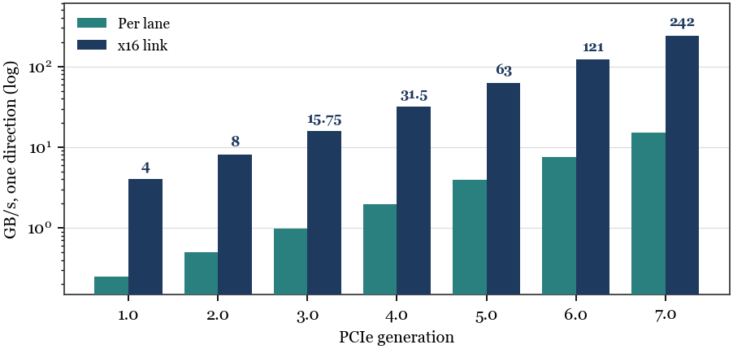

# The x16 Ceiling

**Connector, Silicon, and Latency Constraints on Memory Bandwidth over PCI Express**

Amrendra Singh and DeepSeek V4.1 Flash 1017 · 2026

[Read the paper (PDF)](The_x16_Ceiling.pdf)



## Abstract

PCI Express has carried memory traffic for two decades. Its per-lane rate has grown fifty-fold and its x16 bandwidth sixty-fold, yet its width has not moved: every generation still terminates at sixteen lanes and a 164-pin edge connector. This paper argues that the bandwidth of memory reached through PCIe is set less by signaling rate than by three rations the standard never lifted — a pin ration at the connector, an area-and-power ration in the SerDes and root complex, and a transaction ration that forces memory traffic into small payloads and a finite tag space. A latency-bound model shows that a single function's 256-tag space caps cache-line throughput at roughly 16 GB/s at one microsecond, and a per-pin comparison shows that PCIe Gen6 and Gen7 now exceed HBM3E, so the gap between the two is a matter of pin count and reach rather than signaling.

## Key results

- **The width is frozen.** x16 bandwidth grew 60× (4 → 242 GB/s), but the connector still carries 64 high-speed data pins and 16 lanes.
- **The link is not the limit for cache-line traffic.** 64-byte payloads are only ~73% efficient, and 256 tags sustain ~16.4 GB/s at 1 µs RTT — about a quarter of Gen5 x16.
- **Concurrency is the hidden ceiling.** Reaching 90% of Gen5 x16 with 64-byte payloads needs ~886 requests in flight, more than three times the extended tag space of one function.
- **PCIe is pin-poor, not pin-slow.** Gen6 delivers 1.89 GB/s per signal pin versus HBM3E's 1.20; the HBM advantage is 1,024 pins and a few millimeters of interposer.

## Files

| Path | What it is |
|---|---|
| `The_x16_Ceiling.pdf` | Compiled paper, 9 pages |
| `tex/paper.tex` | LaTeX source (XeLaTeX, TeX Gyre Termes) |
| `figures/` | Vector figures (PDF for LaTeX; SVG/PNG for reuse) |
| `make_figures.py` | Regenerates all four figures |

## Build

```sh
tectonic -X compile tex/paper.tex
```

or, with a full TeX Live installation:

```sh
cd tex
xelatex paper.tex
```
