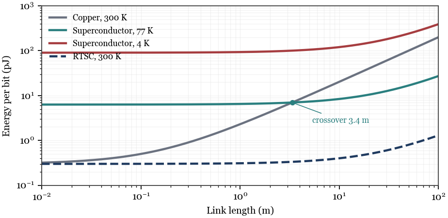

# Zero Resistance, Zero Speedup

**A Room-Temperature Superconductor Would Change Interconnect Reach, Not Latency**

Amrendra Singh and DeepSeek V4.1 Flash 1017 · 2026

[Read the paper (PDF)](Zero_Resistance_Zero_Speedup.pdf)



## Abstract

Superconductivity is the most seductive material promise in computing: a wire with no resistance, carrying data at the speed of light, losing nothing. This position paper argues that the promise is real but misdirected. A superconductor removes DC resistance; it does not remove the driver, the receiver, the package, the connector, or the protocol. At gigahertz frequencies a superconducting line is an LC transmission line with kinetic inductance, and its propagation delay can be longer than copper's. The energy and latency of a link are dominated by the last centimeter — the CMOS interface — not by the wire. Using a first-order link model, we show that zero resistance moves the crossover between electrical and optical links by orders of magnitude in reach, not by a factor in latency. We state the status of the field plainly: no ambient-pressure room-temperature superconductor has been verified; the claims that reached room temperature required megabar pressures or failed replication. We then treat a manufacturable room-temperature superconductor as a hypothesis and derive what would have to be true for it to matter. The answer is a research agenda: measure energy per bit per meter at 300 K, not resistance at 4 K.

## Key results

- **The premise is not yet a fact.** No ambient-pressure room-temperature superconductor has been verified. The highest accepted transition temperature at ambient pressure is about 150 K; the highest at high pressure is about 250 K at roughly 150 GPa. The 2020 and 2023 room-temperature claims were retracted, and LK-99 was shown not to be a superconductor.
- **Zero resistance is not zero interface.** A superconductor replaces the wire, not the driver, receiver, package, connector, or protocol. At 1 m, the wire is 1–2% of the link's latency; the protocol round trip is about 500 ns.
- **A superconductor can be slower.** Kinetic inductance raises the line's inductance and lowers its propagation velocity; a thin-film line can run at 0.1–0.5c, below copper's 0.5c.
- **Cryogenics, not resistance, sets the crossover.** At 4 K the cryogenic overhead is roughly 300×, so a superconducting data link never beats copper. At 77 K it wins beyond about 3 m. A 300 K superconductor wins everywhere, but the absolute saving at 0.1 m is small.
- **The first wins are elsewhere.** Power delivery and cryogenic systems — quantum, SFQ, detectors — are the natural first applications. Cache-line memory is not: it is short, latency-bound, and limited by tags and protocol, not by wire resistance.

## Files

| Path | What it is |
|---|---|
| `Zero_Resistance_Zero_Speedup.pdf` | Compiled paper, 8 pages |
| `tex/paper.tex` | LaTeX source (XeLaTeX, TeX Gyre Termes) |
| `figures/` | Vector figures (PDF for LaTeX; SVG/PNG for reuse) |
| `make_figures.py` | Regenerates all four figures |

## Build

```sh
tectonic -X compile tex/paper.tex
```

or, with a full TeX Live installation:

```sh
cd tex
xelatex paper.tex
```
