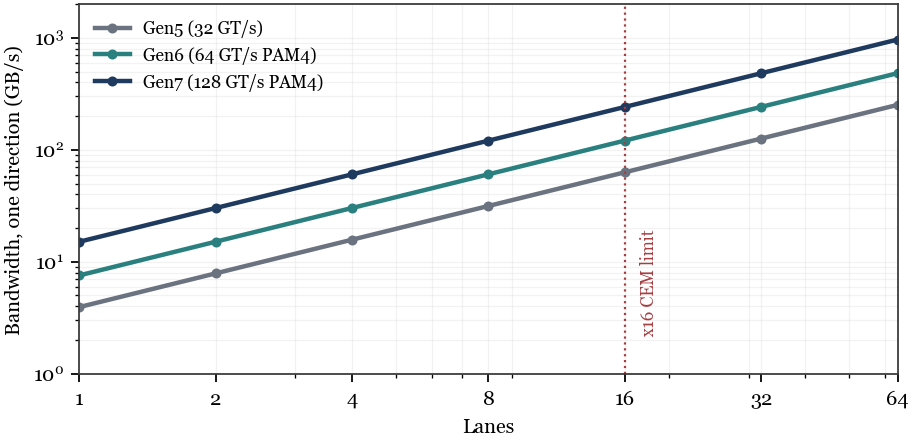

# The Width Tax

**Electrical, Package, and Thermal Limits of Bigger PCIe Links**

Amrendra Singh and DeepSeek V4.1 Flash 1017 · 2026

[Read the paper (PDF)](The_Width_Tax.pdf)



## Abstract

PCI Express scales bandwidth by adding lanes. The x16 connector has been the top of the CEM standard for two decades, and the obvious next step — x32 — is blocked less by the protocol than by physics: pins, package escapes, crosstalk, SerDes power, and thermal density. This paper builds a first-order lane budget that treats width, rate, modulation, and reach as a single optimization. We show that each additional lane carries a superlinear width tax in connector density, package layers, and local thermal load; that the alternative — fewer, faster lanes — trades pins for channel loss and equalization power; that lane merging and width reduction are useful for yield, power, and latency-bound workloads but not for peak bandwidth; and that no lanes at all — optics, wireless, and package-level fabrics — wins at the extremes of reach. The result is a lane frontier: parallel buses at short reach, PCIe lanes in the middle, and optics beyond a few meters. The next PCIe generation should expose width, rate, and modulation as a tunable triad rather than treating lane count as the only scaling knob.

## Key results

- **x16 is the CEM ceiling.** The protocol permits x32; the 164-pin connector, the package, and the channel do not. x64 is hypothetical.
- **The width tax is superlinear where it hurts.** Data pins and package bumps scale linearly, but connector cost, retimer count, PCB layers, and local thermal density grow faster.
- **Power is modest but concentrated.** A Gen6 x16 link burns 1.6–2.4 W; x64 burns 6.4–9.6 W, plus 4–8 retimers at 1–2 W each — about 13% of a 75 W slot, in the last centimeter where airflow is worst.
- **Fewer, faster lanes trade pins for reach.** x8 at 64 GT/s PAM4 carries about the same bandwidth as x16 at 32 GT/s NRZ, with half the pins and roughly half the reach.
- **PAM4 costs 9.5 dB, PAM8 about 19 dB.** Wider modulation is a deeper constellation, not a free doubling; reach falls as the constellation deepens.
- **Width reduction is a workload decision.** For 64-byte cache-line traffic with 256 tags at 1 µs, effective bandwidth saturates at x4; for 4 KB streaming, it scales with width.
- **Lane-less wins at the extremes.** Optics beyond 10 m, UCIe/HBM below 5 mm, CXL over Ethernet beyond 100 m. PCIe lanes are the middle-distance compromise.

## Files

| Path | What it is |
|---|---|
| `The_Width_Tax.pdf` | Compiled paper, 8 pages |
| `tex/paper.tex` | LaTeX source (XeLaTeX, TeX Gyre Termes) |
| `figures/` | Vector figures (PDF for LaTeX; SVG/PNG for reuse) |
| `make_figures.py` | Regenerates all five figures |

## Build

```sh
tectonic -X compile tex/paper.tex
```

or, with a full TeX Live installation:

```sh
cd tex
xelatex paper.tex
```
